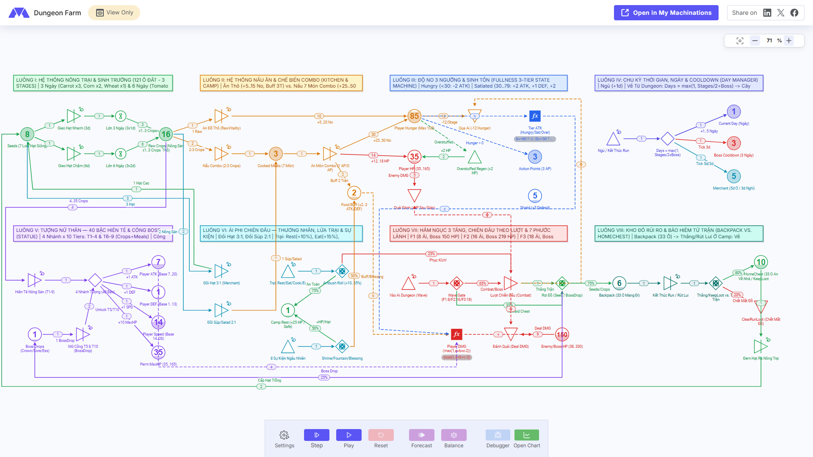
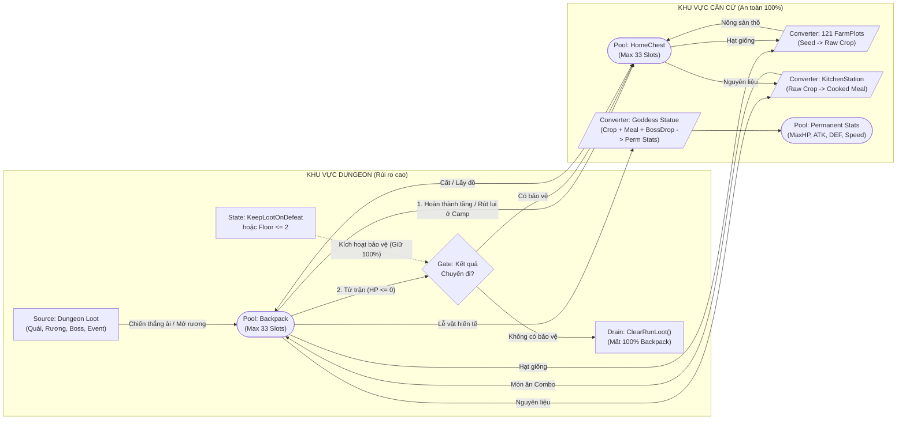
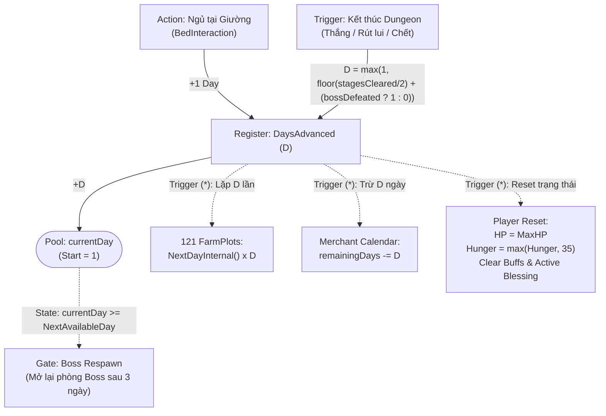
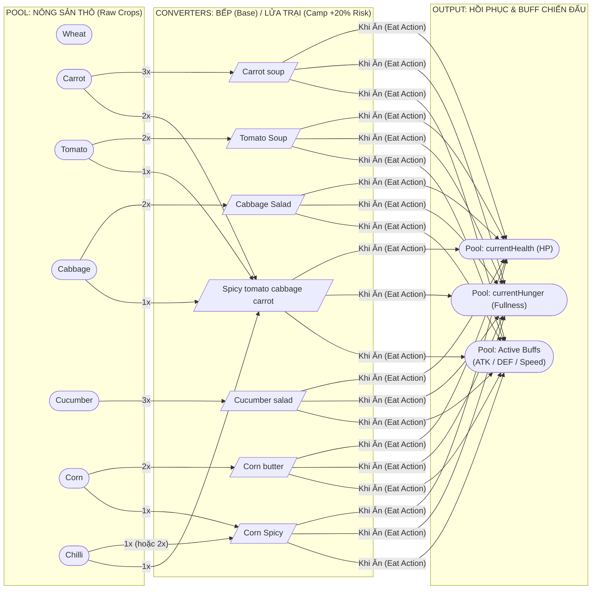
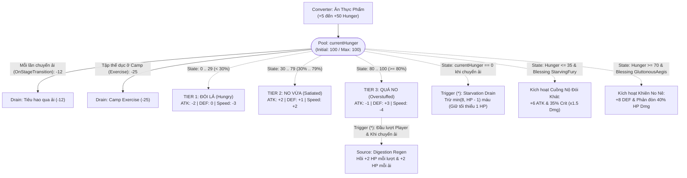
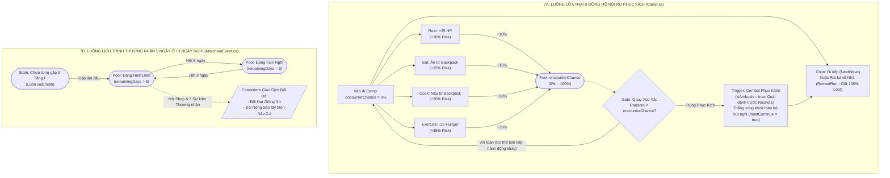
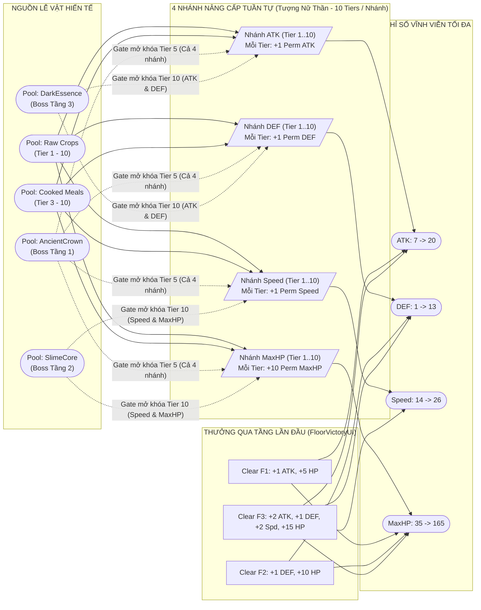

# Thiết Kế Hệ Thống Machinations.io — Dự Án *Harvest & Hollow* (Dungeon-Farm)



Tài liệu này mô hình hóa toàn bộ cơ chế của dự án game **Harvest & Hollow** (`c:\Users\dohuu\Documents\Unity\2D\Farming`) theo chuẩn ký hiệu của **[Machinations.io](https://my.machinations.io/d/dungeon-farm/bbc986eec2bc11f189880abc5ce0dcc9)**, được trích xuất **chính xác 100% từ code C# và dữ liệu ScriptableObject** trong dự án.

> [!IMPORTANT]
> **Đặc trưng kinh tế cốt lõi (Zero-Gold & Zero-EXP Economy):**
> Game **không có Vàng (Gold)** và **không có Điểm kinh nghiệm (EXP)**. Toàn bộ vòng lặp sinh tồn, chiến đấu, giao thương và nâng cấp vĩnh viễn đều vận hành trực tiếp qua **4 dòng vật phẩm**:
> 1. **Seeds (Hạt giống — 7 loại)**: Rơi từ Quái/Rương/Sự kiện Dungeon $\rightarrow$ Đem về trồng tại Nông trại hoặc đổi 3:1 tại Thương nhân.
> 2. **Raw Crops / Produce (Nông sản thô — 7 loại)**: Thu hoạch từ Nông trại sau khi qua ngày $\rightarrow$ Ăn trực tiếp, Nấu ăn, Đổi 2:1 tại Thương nhân, hoặc Hiến tế Tượng Nữ Thần.
> 3. **Cooked Combo Meals (Món ăn chế biến — 7 món)**: Nấu tại Bếp (Base) hoặc Trại (Dungeon) $\rightarrow$ Hồi HP/Độ no lớn, cấp Buff chiến đấu dài hạn (`2 Combats` / `1 Floor`) và Hiến tế Tượng cấp cao (Tier 3–10).
> 4. **Boss Drops (Tín vật Boss — 3 loại)**: Rơi 100% từ Boss Tầng 1–3 $\rightarrow$ Chìa khóa mở cổng nâng cấp Tượng Nữ Thần ở **Tier 5** và **Tier 10**.

---

## Quy Ước Ký Hiệu Node Trên Machinations.io

Khi dựng trên bảng [dungeon-farm](https://my.machinations.io/d/dungeon-farm/bbc986eec2bc11f189880abc5ce0dcc9), hãy chia bảng thành **8 Khung (Group Boxes)** tương ứng với **8 Luồng Cơ Chế** dưới đây:

| Ký hiệu Machinations | Loại Node | Vai trò trong mô hình *Harvest & Hollow* |
| :--- | :--- | :--- |
| **`(O)` Pool** | Kho chứa tài nguyên | Chứa `HP`, `Hunger`, `AP`, `Shield`, `Day`, `Seeds`, `Raw Crops`, `Cooked Meals`, `Boss Drops`, `Permanent Stats`. |
| **`(/\)` Source** | Nguồn sinh tài nguyên | Rơi đồ từ Quái (`Enemy Loot`), Rương (`RewardChest`), Phần thưởng qua tầng, Hồi phục đầu lượt/qua ngày. |
| **`(\/)` Drain** | Nguồn tiêu hao tài nguyên | Mất `Hunger` mỗi ải (`-12`), Mất `HP` khi trúng đòn/chết đói, Xóa đồ trong `Backpack` khi chết, Tiêu hao `AP`. |
| **`(|>)` Converter** | Bộ chuyển đổi | Trồng cây (`Seed -> Crop`), Nấu ăn (`Raw Crops -> Combo Meal`), Đổi đồ Thương nhân (`3:1`, `2:1`), Hiến tế Tượng (`Items -> Perm Stat`). |
| **`[?]` Gate (Probabilistic / Skill)** | Cổng phân phối / Xác suất | Rơi đồ theo `%`, Quay rủi ro Phục kích ở Trại (`AmbushChance`), Tỉ lệ Chí mạng `35%` của *StarvingFury*, Random Event. |
| **`[f(x)]` Register** | Biến công thức động | Tính `EffectiveATK`, `EffectiveDEF`, `EffectiveSpeed`, `DamageDealt`, `DaysAdvanced`, `EnemyFloorScale`. |
| **`--->` Resource Connection** | Luồng di chuyển tài nguyên | Đường liền nét chuyển số lượng tài nguyên giữa các Pool/Converter. |
| **`- - >` State Connection / Trigger (`*`)** | Luồng trạng thái / Kích hoạt | Đường nét đứt kiểm tra điều kiện (`Hunger` 3 ngưỡng, Boss `<= 50% HP`, Cooldown 3 ngày) hoặc kích hoạt (`*`). |

---

## Luồng 1: Vòng Lặp Cốt Lõi & Quản Lý Kho Đồ (Core Macro Loop & Inventory Risk Flow)

Luồng này biểu diễn sự luân chuyển vĩ mô giữa **Căn cứ (Base)** và **Hầm ngục (Dungeon)**, đặc biệt là cơ chế bảo hiểm rủi ro giữa **`Backpack`** (mang theo người) và **`HomeChest`** (rương tại nhà).



### Bảng Node & Quy Tắc Luồng 1 (`Inventory.asset`, `HomeChest.asset`, `CombatManager.cs`)
| Tên Node | Loại Node | Giá trị ban đầu / Giới hạn | Công thức / Điều kiện kết nối |
| :--- | :---: | :---: | :--- |
| **`Backpack`** | Pool | Khởi đầu: `3x CarrotSeed`<br>Max: `33 slots` | Nhận toàn bộ chiến lợi phẩm trong Dungeon. Dùng để Ăn, Nấu tại Trại, Giao dịch Thương nhân. |
| **`HomeChest`** | Pool | Khởi đầu: `0`<br>Max: `33 slots` | Kho an toàn tại Căn cứ. Không bao giờ bị mất khi tử trận trong Dungeon. Bếp ở Base tự động rút nguyên liệu từ `Backpack` trước, thiếu mới rút từ `HomeChest`. |
| **`StarterProtection`** | State Condition | `highestUnlockedFloor <= 2` | Khi chưa mở khóa quá Tầng 2, người chơi tử trận **không bị mất đồ** trong `Backpack`. |
| **`KeepLootOnDefeat`** | Blessing State | `activeBlessing == 1` | Phước lành *Giữ Chiến Lợi Phẩm*: Chặn lệnh `ClearRunLoot()` khi `currentHealth <= 0` ở Tầng 3+. |

---

## Luồng 2: Chu Kỳ Thời Gian & Tiến Trình Ngày (Time & Day Advancement Flow)

Mọi bộ đếm thời gian trong game (Cây lớn, Thương nhân đến/đi, Boss hồi sinh) đều được điều khiển bởi số ngày tăng thêm **`DaysAdvanced` ($D$)**.



### Bảng Công Thức Thời Gian (`DayManager.cs`, `DungeonSummaryUI.cs`, `ProgressionManager.cs`)
- **Công thức tính ngày khi rời Dungeon (`Register: DaysAdvanced`)**:
  - Nếu `Floor == 0` (Tutorial): $D = 1$
  - Nếu `Floor >= 1`:
    $$D = \max\Big(1,\; \Big\lfloor \frac{\text{stagesCleared}}{2} \Big\rfloor + (\text{bossDefeated} \mathrel{?} 1 : 0)\Big)$$
  - *Ví dụ thực tế*:
    - Clear toàn bộ Tầng 1 (8 ải + hạ Boss): $D = \lfloor 8/2 \rfloor + 1 = \mathbf{5\text{ ngày}}$.
    - Rút lui tại Trại Tầng 2 ở ải 9 (đã qua 8 ải, chưa hạ Boss): $D = \lfloor 8/2 \rfloor + 0 = \mathbf{4\text{ ngày}}$.
    - Tử trận ngay ải 1: $D = \max(1, 0) = \mathbf{1\text{ ngày}}$.
- **Hồi sinh Boss (`Boss Cooldown Gate`)**:
  - Khi hạ Boss ở tầng $F$ vào ngày `currentDay`, hệ thống đặt `BossNextAvailableDay[F] = currentDay + 3` (`defaultBossResetDays = 3`).
  - Nếu người chơi quay lại ải Boss tầng $F$ khi `currentDay < BossNextAvailableDay[F]`, phòng Boss sẽ trống (`HandleEmptyBossStage`) và cho phép đi tiếp/về nhà ngay.

---

## Luồng 3: Hệ Thống Nông Trại & Sinh Trưởng Cây Trồng (Farming & Crop Growth Flow)

Tại Base có **121 ô đất (`FarmPlot_0` .. `FarmPlot_120`)**. Mỗi hạt giống gieo xuống sẽ đi qua **3 giai đoạn tăng trưởng (`maxStage = 3`)** trước khi thu hoạch.

```mermaid
flowchart LR
    SeedPool(["Pool: Seeds<br/>(7 loại hạt giống)"])
    PlantGate[/"Converter: Gieo Hạt<br/>(-1 Seed)"/]
    Stage0(["Pool: Stage 0<br/>(Mới gieo)"])
    Stage1(["Pool: Stage 1<br/>(Nảy mầm)"])
    Stage2(["Pool: Stage 2<br/>(Đang lớn)"])
    Stage3(["Pool: Stage 3 (Ready)<br/>(Chín - Sẵn sàng thu hoạch)"])
    HarvestConv[/"Converter: Thu Hoạch<br/>(nhân hệ số harvestAmount)"/]
    CropPool(["Pool: Raw Crops<br/>(7 loại nông sản thô)"])

    SeedPool -->|"1 Seed"| PlantGate --> Stage0
    Stage0 -->|"Delay: growthTime ngày"| Stage1
    Stage1 -->|"Delay: growthTime ngày"| Stage2
    Stage2 -->|"Delay: growthTime ngày"| Stage3
    Stage3 --> HarvestConv -->|"1x, 2x hoặc 3x Crop"| CropPool
```



### Bảng Thông Số Converter Cho 7 Loại Cây Trồng (`FarmPlot.cs`, `Crops\*.asset`)
> [!NOTE]
> Trong code `FarmPlot.cs`, cây chuyển giai đoạn khi `daysInCurrentStage >= growthTime` và chín khi đạt `currentStage >= maxStage (3)`. Do đó **Tổng số ngày chín = `3 * growthTime`**.

| Hạt giống đầu vào (`1x`) | Tên Nông sản đầu ra | `growthTime` (Ngày / Giai đoạn) | Số Giai đoạn (`maxStage`) | **Tổng Ngày Chín (`Delay`)** | **Sản lượng thu hoạch (`harvestAmount`)** | Tỷ suất nhân vật phẩm | Nguồn rơi Hạt giống chính |
| :--- | :--- | :---: | :---: | :---: | :---: | :---: | :--- |
| **`WheatSeed`** | **`Wheat`** (Lúa mì) | `1 ngày` | `3` | **3 Ngày** | **`1x Wheat`** | `1 -> 1` | Tầng 1+ (Slime, Skeleton, Bowman, Bomb) |
| **`CarrotSeed`** | **`Carrot`** (Cà rốt) | `1 ngày` | `3` | **3 Ngày** | **`3x Carrot`** | **`1 -> 3`** | Tầng 0–1+ (Khởi đầu 3 hạt, Slime, Skeleton, Rat) |
| **`CornSeed`** | **`Corn`** (Ngô) | `1 ngày` | `3` | **3 Ngày** | **`2x Corn`** | **`1 -> 2`** | Tầng 1 (Skeleton 35%), Tầng 2+ (ME1, Range, Flying), Đổi 3:1 CarrotSeed |
| **`TomatoSeed`** | **`Tomato`** (Cà chua) | `2 ngày` | `3` | **6 Ngày** | **`1x Tomato`** | `1 -> 1` | Tầng 1 (Bowman 35%), Tầng 2+ (Range), Đổi 3:1 WheatSeed |
| **`CabbageSeed`** | **`Cabbage`** (Bắp cải) | `2 ngày` | `3` | **6 Ngày** | **`3x Cabbage`** | **`1 -> 3`** | Tầng 2+ (ME1, Flying, ME2), Đổi 3:1 CucumberSeed |
| **`CucumberSeed`** | **`Cucumber`** (Dưa chuột) | `2 ngày` | `3` | **6 Ngày** | **`3x Cucumber`** | **`1 -> 3`** | Tầng 2+ (Flying, SlimeBoss), Đổi 3:1 CabbageSeed |
| **`ChilliSeed`** | **`Chilli`** (Ớt cay) | `2 ngày` | `3` | **6 Ngày** | **`3x Chilli`** | **`1 -> 3`** | Tầng 2 Boss (60%), Tầng 3 (ME2, FlyingRider), Đổi 3:1 CornSeed |

---

## Luồng 4: Hệ Thống Nấu Ăn & Chế Biến Thực Phẩm (Cooking & Food Buff Converter Flow)

Luồng nấu ăn là **bộ khuếch đại giá trị (Value Multiplier Converter)** quan trọng nhất: biến nông sản thô (chỉ hồi ít máu/độ no và buff ngắn hạn `3 Turns`) thành món ăn Combo (hồi phục lớn và giữ buff xuyên suốt `2 Combats` hoặc `1 Floor`).



### Bảng So Sánh Hiệu Suất Ăn Thô vs. Nấu Chín (`FoodData`, `RecipeData`)

| Tên Thực Phẩm | Phân loại | Nguyên liệu đầu vào (`Converter Input`) | Hồi Độ No (`+Hunger`) | Hồi Máu (`+HP`) | Hiệu ứng Buff (`StatEffectData`) | Thời hạn Buff *(Nhân đôi nếu có `EndlessFeast`)* |
| :--- | :---: | :--- | :---: | :---: | :--- | :--- |
| **`Wheat`** | Ăn thô (`ItemData`) | `1x Wheat` | `+15` *(+20 RawVitality)* | `+6` *(+12 RawVitality)* | Không có | — |
| **`Carrot`** | Ăn thô (`FoodData`) | `1x Carrot` | `+5` | `+5` | **`+1 ATK`** | `3 Turns` (Lượt) |
| **`Tomato`** | Ăn thô (`FoodData`) | `1x Tomato` | `+7` | `+10` | **`+2 DEF`** | `3 Turns` (Lượt) |
| **`Cabbage`** | Ăn thô (`FoodData`) | `1x Cabbage` | `+9` | `+10` | **`+2 DEF`** | `3 Turns` (Lượt) |
| **`Cucumber`** | Ăn thô (`FoodData`) | `1x Cucumber` | `+9` | `+4` | **`+1 DEF`** | `3 Turns` (Lượt) |
| **`Corn`** | Ăn thô (`FoodData`) | `1x Corn` | `+10` | `+10` | **`+2 Speed`** | `3 Turns` (Lượt) |
| **`Chilli`** | Ăn thô (`FoodData`) | `1x Chilli` | `+5` | `+2` | **`+2 ATK` & `+5 Speed`** | `3 Turns` (Lượt) |
| **`Carrot soup`** | Món nấu Combo | **`3x Carrot`** *(tương đương 1 hạt)* | **`+25`** | **`+12`** | **`+2 ATK`** | **`2 Combats`** (Trận) |
| **`Tomato Soup`** | Món nấu Combo | **`2x Tomato`** *(hoặc `2 Tomato + 1 Cabbage`)* | **`+25`** | **`+12`** | **`+2 DEF`** | **`2 Combats`** (Trận) |
| **`Cabbage Salad`** | Món nấu Combo | **`2x Cabbage`** *(hoặc `2 Cabbage + 1 Tomato + 1 Carrot`)* | **`+30`** | **`+12`** | **`+2 DEF`** | **`2 Combats`** (Trận) |
| **`Cucumber salad`** | Món nấu Combo | **`3x Cucumber`** *(tương đương 1 hạt)* | **`+28`** | **`+12`** | **`+1 DEF` & `+2 Speed`** | **`2 Combats`** (Trận) |
| **`Corn butter`** | Món nấu Combo | **`2x Corn`** *(tương đương 1 hạt)* | **`+35`** | **`+14`** | **`+2 DEF` & `+3 Speed`** | **`2 Combats`** (Trận) |
| **`Corn Spicy`** | Món nấu Combo | **`1x Corn + 1x Chilli`** *(hoặc `1 Corn + 2 Chilli`)* | **`+30`** | **`+10`** | **`+2 ATK` & `+3 Speed`** | **`2 Combats`** (Trận) |
| **`Spicy tomato cabbage carrot`** | Món nấu Đại Tiệc | **`1x Chilli + 2x Carrot + 1x Cabbage + 1x Tomato`** | **`+50`** | **`+18`** | **`+3 ATK`, `+2 DEF`, `+2 Speed`** | **`1 Floor`** (Toàn bộ tầng) |

---

## Luồng 5: Cơ Chế Độ No 3 Ngưỡng (Fullness 3-Tier State Machine) & Tiêu Hao Chuyển Ải

Trong Machinations, **`currentHunger` (`0 .. 100`)** là một **Pool trung tâm phát ra các State Connections (`- - >`)** làm thay đổi trực tiếp chỉ số chiến đấu và rút/hồi máu theo từng bước di chuyển trong Dungeon.



### Điểm Cân Bằng Chiến Thuật Trên Machinations (`PlayerStats.cs`)
1. **Chiến thuật Chuẩn (`Satiated: 30–79`)**: Giữ độ no ở khoảng giữa để nhận đồng thời **`+2 ATK, +1 DEF, +2 Speed`**.
2. **Chiến thuật Tank / Hồi phục (`Overstuffed: 80–100` + `GluttonousAegis`)**: Chấp nhận bị phạt `-1 ATK, -4 Speed` để lấy **`+3 DEF` (cộng thêm `+8 DEF` từ Khiên No Nê = `+11 DEF`)**, phản sát thương `40%` và tự hồi **`+2 HP`** mỗi lượt + mỗi ải.
3. **Chiến thuật Sát Thủ Liều Mạng (`Hunger <= 35` + `StarvingFury`)**: Dùng nút `Exercise (-25 Hunger)` tại Camp hoặc nhịn ăn để ép độ no xuống $\le 35$, kích hoạt **`+6 ATK`** và **`35%` tỉ lệ Chí mạng (`x1.5`)** (Lý tưởng nhất là giữ ở ngưỡng **`30 .. 35`** để vừa hưởng `+2 ATK, +2 Speed` của `Satiated`, vừa kích hoạt `StarvingFury`!).

---

## Luồng 6: Hệ Thống Chiến Đấu Theo Lượt, Công Thức Sát Thương & Phước Lành (Turn-Based Combat Engine)

Mô hình chi tiết một trận đánh theo lượt giữa **Player** và **Quái/Boss** (`CombatManager.cs`, `EnemyStats.cs`, `SpeedManager.cs`).

```mermaid
flowchart TB
    subgraph TURN_INIT["1. KHỞI TẠO LƯỢT NGƯỜI CHƠI (StartPlayerTurn)"]
        AP_Source["Source: Reset AP"] -->|"Set = 3"| AP_Pool(["Pool: currentAP (Max 3)"])
        ShieldReset["Drain: Xóa Shield cũ"] <-- "Set = 0" --- ShieldPool(["Pool: currentShield"])
    end

    subgraph PLAYER_ACTIONS["2. HÀNH ĐỘNG CỦA NGƯỜI CHƠI (Tiêu hao AP)"]
        ActAttack[/"Converter: Attack<br/>(Cost: 1 AP)"/]
        ActDefend[/"Converter: Defend<br/>(Cost: 1 AP, hoặc 0 AP lần đầu nếu BastionStrike)"/]
        ActEat[/"Converter: Eat Food<br/>(Cost: 1 AP, hoặc 0 AP lần đầu nếu EndlessFeast)"/]
    end

    AP_Pool -->|"1 AP"| ActAttack & ActDefend & ActEat
    ActDefend -->|"+5 Shield"| ShieldPool
    ActEat -->|"Hồi HP, Hunger, Buff"| PlayerHP(["Pool: Player HP"])

    subgraph STAT_REGISTERS["3. REGISTERS: TÍNH CHỈ SỐ HIỆU DỤNG & SÁT THƯƠNG"]
        RegDEF["Register: EffectiveDEF<br/>= max(0, baseDEF + permDEF + TierDEF + Aegis(8) + BuffDEF)"]
        RegATK["Register: EffectiveATK<br/>= max(0, baseATK + permATK + TierATK + round(EffDEF*0.5)[Bastion] + Fury(6) + BuffATK)"]
        RegSpd["Register: EffectiveSpeed<br/>= max(0, baseSpd + permSpd + TierSpd + Swift(4) + BuffSpd)"]
        DmgToEnemy["Register: PlayerDmg<br/>= max(1, (EffATK + SwiftDiff) * Crit(1.5) - EnemyDEF)"]
    end

    RegDEF -.->|"Nếu có BastionStrike (+50% DEF)"| RegATK
    ActAttack --> DmgToEnemy
    RegATK & RegSpd -.-> DmgToEnemy
    DmgToEnemy -->|"Trừ HP Quái (+4 True Dmg & -2 DEF nếu BitterDecay)"| EnemyHP(["Pool: Enemy HP"])

    subgraph ENEMY_TURN["4. LƯỢT QUÁI & BOSS (PerformIntentAction)"]
        EnemyIntent{"Gate: Random Intent<br/>(Uniform từ possibleIntents)"}
        E_Atk["Intent: Attack<br/>NetDmg = max(0, EnemyATK - EffectiveDEF)"]
        E_Def["Intent: Defend<br/>+max(5, BaseDEF) trong 1 vòng"]
        E_Buff["Intent: Buff / Debuff<br/>(2 Turns)"]
        BossPhase["State Trigger: Boss HP <= 50%<br/>(+5 ATK, +2 Speed vĩnh viễn trong trận)"]
    end

    EnemyHP -.->|"<= 50% MaxHP"| BossPhase
    EnemyIntent --> E_Atk & E_Def & E_Buff
    E_Atk -->|"Trừ vào Shield trước"| ShieldPool
    E_Atk -->|"HPDmg = max(0, NetDmg - Shield)"| PlayerHP
    PlayerHP -.->|"Nếu HPDmg > 0 & GluttonousAegis (Hunger >= 70):<br/>Phản max(1, round(HPDmg*0.4) - EnemyDEF)"| EnemyHP
```

### Bảng Công Thức Toán Học Cho Các Register Chiến Đấu (`PlayerStats.cs`, `EnemyStats.cs`, `CombatManager.cs`)

1. **Thứ tự lượt đánh (`SpeedManager`)**:
   - Bình thường: Sắp xếp tất cả thực thể còn sống theo `EffectiveSpeed` giảm dần (nếu bằng nhau thì trộn ngẫu nhiên).
   - **Khi bị Phục kích tại Trại (`isAmbush == true` ở Round 1)**: Toàn bộ Quái được xếp lên đầu hàng đợi (theo Speed của quái), Người chơi bị ép xuống cuối hàng đợi. Từ Round 2 trở đi tính lại theo Speed bình thường.
2. **Công thức chỉ số Quái tự động tăng theo Tầng $F$ (`EnemyStats.Awake`)**:
   - Với $F \ge 1$:
     $$\text{EnemyMaxHP}_F = \text{RoundToInt}\Big(\text{BaseHP} \times \big(1 + 0.25 \times (F - 1)\big)\Big)$$
     $$\text{EnemyATK}_F = \text{BaseATK} + 2 \times (F - 1)$$
     $$\text{EnemyDEF}_F = \text{BaseDEF} + 1 \times (F - 1)$$
3. **Khác biệt quan trọng giữa Sát thương Người chơi và Sát thương Quái**:
   - **Người chơi đánh Quái (`EnemyStats.TakeDamage`)**: Luôn gây tối thiểu **`1` sát thương** ($\max(1, \text{ATK} - \text{EnemyDEF})$).
   - **Quái đánh Người chơi (`CombatManager.PerformIntentAction`)**: Có thể bị chặn về **`0` sát thương** nếu `EffectiveDEF + currentShield >= EnemyATK` ($\max(0, \text{EnemyATK} - \text{PlayerDEF})$).

### Bảng Thông Số Quái & Boss Trên Từng Tầng (`Assets\_Assets\ScriptableObjects\Enemy\*.asset`)

| Tên Quái / Boss | Tầng xuất hiện | Chỉ số Gốc (`HP / ATK / DEF / Spd`) | Chỉ số Thực Tế theo Tầng (`HP / ATK / DEF`) | Các Ý Định (`possibleIntents` - Xác suất đều nhau) | Hiệu ứng Kỹ năng `Buff` / `Debuff` (`2 Turns`) | Vật phẩm rơi (`Loot Drops`) |
| :--- | :---: | :---: | :---: | :--- | :--- | :--- |
| **`Slime`** | F0, F1, F2 | `38 / 8 / 1 / 8` | **F1**: `38 / 8 / 1`<br>**F2**: `48 / 10 / 2` | `Attack, Buff, Debuff` | Buff: `+2 DEF` (Bản thân)<br>Debuff: `-2 ATK` (Player) | `WheatSeed` 60% (1–2), `CarrotSeed` 50% (1–2) |
| **`Skeleton`** | F1 | `36 / 11 / 2 / 14` | **F1**: `36 / 11 / 2` | `Attack, Defend, Buff` | Buff: `+2 ATK` (Đồng minh) | `CarrotSeed` 65% (1–2), `WheatSeed` 50% (1–2), `CornSeed` 35% (1) |
| **`Skeleton_Bowman`** | F1 | `30 / 11 / 1 / 18` | **F1**: `30 / 11 / 1` | `Attack, Defend, Debuff` | Debuff: `-2 DEF` (Player) | `WheatSeed` 60% (1–2), `CarrotSeed` 50% (1–2), `TomatoSeed` 35% (1) |
| **`Bombschroom`** | F1 | `25 / 13 / 0 / 13` | **F1**: `25 / 13 / 0` | `Attack, Buff, Debuff` | Buff: `+3 ATK` (Bản thân)<br>Debuff: `-3 DEF` (Player) | `WheatSeed` 60% (1–2), `CarrotSeed` 50% (1–2) |
| **`Rat`** | F2 | `26 / 9 / 0 / 17` | **F2**: `33 / 11 / 1` | `Attack, Debuff` | Debuff: `-2 DEF` (Player) | `CarrotSeed` 60% (1–2), `WheatSeed` 50% (1–2) |
| **`Bat`** | F2, F3 | `28 / 10 / 0 / 20` | **F2**: `35 / 12 / 1`<br>**F3**: `42 / 14 / 2` | `Attack, Debuff` | Debuff: `-2 ATK` (Player) | `CarrotSeed` 55% (1–2), `WheatSeed` 50% (1–2) |
| **`ME1`** | F2, F3 | `54 / 14 / 3 / 15` | **F2**: `68 / 16 / 4`<br>**F3**: `81 / 18 / 5` | `Attack, Defend, Buff` | Buff: `+3 ATK` (Bản thân) | `CabbageSeed` 65% (1–2), `CornSeed` 60% (1–2) |
| **`Range`** | F2, F3 | `42 / 14 / 2 / 18` | **F2**: `53 / 16 / 3`<br>**F3**: `63 / 18 / 4` | `Attack, Defend, Debuff` | Debuff: `-3 DEF` (Player) | `TomatoSeed` 60% (1–2), `CornSeed` 55% (1–2) |
| **`Flying`** | F2, F3 | `44 / 12 / 2 / 19` | **F2**: `55 / 14 / 3`<br>**F3**: `66 / 16 / 4` | `Attack, Defend, Debuff` | Debuff: `-2 ATK` (Player) | `CabbageSeed` 60% (1–2), `CucumberSeed` 50% (1–2), `CornSeed` 40% (1) |
| **`ME2`** | F3 | `72 / 16 / 4 / 11` | **F3**: `108 / 20 / 6` | `Attack, Defend, Buff` | Buff: `+3 DEF` (Đồng minh) | `ChilliSeed` 65% (1–2), `CabbageSeed` 65% (2–3), `CornSeed` 60% (2–3) |
| **`Boss_Skeleton_King`** | **Boss F1** | `150 / 16 / 3 / 14` | **F1**: `150 / 16 / 3`<br>*(<=50% HP: 21 ATK, 16 Spd)* | `Attack, Defend, Buff, Debuff` | Buff: `+3 ATK` (Đồng minh)<br>Debuff: `-3 DEF` (Player) | **`AncientCrown` 100% (1)**, `CarrotSeed` 100% (3–5), `WheatSeed` 100% (3–5), `CornSeed` 80% (2–3), `TomatoSeed` 75% (2–3), `Carrot soup` 60% (1–2) |
| **`SlimeBoss`** | **Boss F2** | `175 / 16 / 3 / 12` | **F2**: `219 / 18 / 4`<br>*(<=50% HP: 23 ATK, 14 Spd)* | `Attack, Defend, Buff, Debuff` | Buff: `+3 DEF` (Bản thân)<br>Debuff: `-3 ATK` (Player) | **`SlimeCore` 100% (1)**, `CabbageSeed` 100% (3–5), `CornSeed` 100% (3–5), `TomatoSeed` 90% (2–4), `CucumberSeed` 85% (2–3), `ChilliSeed` 60% (1–2), `Corn butter` 70% (1–2) |
| **`FlyingRider`** | **Boss F3** | `220 / 19 / 4 / 20` | **F3**: `330 / 23 / 6`<br>*(<=50% HP: 28 ATK, 22 Spd)* | `Attack, Defend, Buff, Debuff` | Buff: `+4 ATK` (Bản thân)<br>Debuff: `-4 DEF` (Player) | **`DarkEssence` 100% (1)**, `ChilliSeed` 100% (4–6), `TomatoSeed` 100% (4–6), `CornSeed` 100% (4–6), `CucumberSeed` 90% (3–5), `Spicy tomato...` 100% (2) |

---

## Luồng 7: Tiến Trình Ải Dungeon, Cắm Trại, Thương Nhân & Sự Kiện (Dungeon Nodes & Risk/Barter Flow)

Luồng này mô tả cấu trúc các ải phi chiến đấu trong Dungeon: **Lửa Trại (`Camp`)**, **Thương Nhân (`Merchant`)**, **Rương Thưởng (`RewardChest`)** và **Sự Kiện Ngẫu Nhiên (`DungeonEventManager`)**.



### Bảng Giao Dịch Thương Nhân (`MerchantEvent.cs`)
- **Nhóm Converter 1 — Đổi Hạt Giống Nâng Cấp (Tỉ lệ `3:1`)**:
  1. `3x WheatSeed` $\rightarrow$ `1x TomatoSeed`
  2. `3x CarrotSeed` $\rightarrow$ `1x CornSeed`
  3. `3x CabbageSeed` $\rightarrow$ `1x CucumberSeed`
  4. `3x CornSeed` $\rightarrow$ `1x ChilliSeed`
  5. `3x CucumberSeed` $\rightarrow$ `1x CabbageSeed`
- **Nhóm Converter 2 — Đổi Nông Sản Thô lấy Khẩu Phần Ăn Chín (Tỉ lệ `2:1`)**:
  6. `2x Tomato` $\rightarrow$ `1x Tomato Soup`
  7. `2x Carrot` $\rightarrow$ `1x Carrot soup`
  8. `2x Cabbage` $\rightarrow$ `1x Cabbage Salad`
  9. `2x Cucumber` $\rightarrow$ `1x Cucumber salad`
  10. `2x Corn` $\rightarrow$ `1x Corn butter`
  11. `2x Wheat` $\rightarrow$ `1x Tomato Soup`

### Bảng 8 Sự Kiện Ngẫu Nhiên (`DungeonEventManager.cs`)
| Mã Sự Kiện | Điều kiện xuất hiện | Lựa chọn 1 (`Converter / Gate`) | Lựa chọn 2 (`Converter`) | Lựa chọn 3 |
| :--- | :---: | :--- | :--- | :--- |
| **`Event_Merchant_Seeds`** | Merchant Active | `2x WheatSeed` $\rightarrow$ `2x TomatoSeed` | `1x Wheat` $\rightarrow$ `+3 DEF (6 turns)` & `+15 Hunger` | Mở Shop / Rời đi |
| **`Event_Merchant_Chef`** | Merchant Active | `2x Carrot` $\rightarrow$ `1x Cabbage Salad` + `40 HP` + `30 Hunger` | `1x Carrot` $\rightarrow$ `+4 ATK (6 turns)` + `15 HP` | Mở Shop / Rời đi |
| **`Event_Merchant_Quartermaster`** | Merchant Active | `2x Wheat` $\rightarrow$ `2x Tomato Soup` + `+2 Speed (5 turns)` + `20 HP` | `1x Carrot` $\rightarrow$ `+30 HP` | Mở Shop / Rời đi |
| **`Event_Shrine`** | Luôn mở | `-12 HP` (yêu cầu `HP > 12`) $\rightarrow$ `+3 ATK, +2 DEF (5 turns)` | `-10 Hunger` $\rightarrow$ `+35 HP` | Rời đi |
| **`Event_Fountain`** | Luôn mở | Miễn phí: **`+45 HP` & `+30 Hunger`** | Miễn phí: **`+4 ATK (6 turns)`** | Rời đi |
| **`Event_Relic`** | Luôn mở | **Gate Xác suất**: `70%` nhận `2x Tomato Soup` / `30%` mất `-15 HP` (giữ tối thiểu 1 HP) | `-12 Hunger` $\rightarrow$ `2x Carrot` | Rời đi |
| **`Event_Forager`** | Luôn mở | `1x Carrot` $\rightarrow$ `3x CornSeed` | Miễn phí: **`+2 Speed (5 turns)`** | Rời đi |
| **`Event_Divine_Blessing`** | Luôn mở | `1x Wheat` $\rightarrow$ **Mở khóa vĩnh viễn & Trang bị 1 Blessing ngẫu nhiên** | `-10 Hunger` $\rightarrow$ `+25 HP` & `+3 ATK, +3 DEF, +2 Spd (8 turns)` | Rời đi |

---

## Luồng 8: Tiến Trình Vĩnh Viễn — Tượng Nữ Thần (Goddess Statue 40 Offerings & Boss Gates)

Đây là **Đầu ra dài hạn (End-game Sink & Progression Engine)** của toàn bộ nền kinh tế nông trại và chiến lợi phẩm Boss.



### Bảng Chi Phí Đầy Đủ 40 Bậc Hiến Tế Tượng Nữ Thần (`Assets\_Assets\ScriptableObjects\Offerings\*.asset`)

| Bậc (Tier) | **Nhánh ATK (`+1 ATK` / bậc)** | **Nhánh DEF (`+1 DEF` / bậc)** | **Nhánh Speed (`+1 Speed` / bậc)** | **Nhánh MaxHP (`+10 MaxHP` / bậc)** |
| :---: | :--- | :--- | :--- | :--- |
| **Tier 1** | `4x Carrot` | `4x Wheat` | `4x Tomato` | `5x Wheat` |
| **Tier 2** | `6x Carrot` + `4x Tomato` | `6x Wheat` + `4x Carrot` | `6x Tomato` + `4x Wheat` | `8x Wheat` + `4x Carrot` |
| **Tier 3** | `8x Carrot` + `2x Tomato Soup` | `8x Wheat` + `2x Carrot soup` | `8x Tomato` + `2x Tomato Soup` | `10x Wheat` + `2x Carrot soup` |
| **Tier 4** | `10x Carrot` + `6x Tomato` + `3x Tomato Soup` | `10x Wheat` + `6x Carrot` + `3x Carrot soup` | `10x Tomato` + `6x Carrot` + `3x Carrot soup` | `12x Wheat` + `6x Tomato` + `3x Carrot soup` |
| **Tier 5** *(Gate Boss F1)* | `14x Carrot` + `4x Tomato Soup` + **`1x AncientCrown`** | `14x Wheat` + `4x Carrot soup` + **`1x AncientCrown`** | `14x Tomato` + `4x Tomato Soup` + **`1x AncientCrown`** | `16x Wheat` + `4x Carrot soup` + **`1x AncientCrown`** |
| **Tier 6** | `12x Corn` + `3x Corn butter` | `12x Cabbage` + `3x Cabbage Salad` | `10x Cucumber` + `3x Cucumber salad` | `15x Wheat` + `10x Cabbage` + `3x Cabbage Salad` |
| **Tier 7** | `16x Corn` + `4x Corn butter` + `8x Tomato` | `16x Cabbage` + `4x Cabbage Salad` + `8x Corn` | `14x Cucumber` + `4x Cucumber salad` + `8x Tomato` | `18x Wheat` + `12x Corn` + `4x Corn butter` |
| **Tier 8** | `10x Chilli` + `4x Corn Spicy` | `20x Cabbage` + `5x Cabbage Salad` + `4x Corn butter` | `18x Cucumber` + `5x Cucumber salad` + `4x Tomato Soup` | `22x Wheat` + `12x Cucumber` + `5x Cucumber salad` |
| **Tier 9** | `15x Chilli` + `6x Corn Spicy` + `2x Spicy tomato...` | `25x Cabbage` + `15x Corn` + `2x Spicy tomato...` | `22x Cucumber` + `15x Tomato` + `2x Spicy tomato...` | `25x Wheat` + `15x Cabbage` + `2x Spicy tomato...` |
| **Tier 10** *(Gate Boss F2/F3)* | `25x Chilli` + `15x Corn` + `4x Spicy tomato...` + **`1x DarkEssence`** | `35x Cabbage` + `20x Corn` + `4x Spicy tomato...` + **`1x DarkEssence`** | `30x Cucumber` + `20x Tomato` + `4x Spicy tomato...` + **`1x SlimeCore`** | `35x Wheat` + `20x Cabbage` + `4x Spicy tomato...` + **`1x SlimeCore`** |
| **Tổng Chi Phí 10 Tiers** | `42 Carrot, 10 Tomato, 43 Corn, 50 Chilli, 9 Tomato Soup, 7 Corn butter, 10 Corn Spicy, 6 Spicy tomato, 1 AncientCrown, 1 DarkEssence` | `42 Wheat, 10 Carrot, 108 Cabbage, 43 Corn, 9 Carrot soup, 12 Cabbage Salad, 4 Corn butter, 6 Spicy tomato, 1 AncientCrown, 1 DarkEssence` | `47 Tomato, 4 Wheat, 6 Carrot, 94 Cucumber, 8 Tomato Soup, 3 Carrot soup, 12 Cucumber salad, 6 Spicy tomato, 1 AncientCrown, 1 SlimeCore` | `166 Wheat, 4 Carrot, 6 Tomato, 45 Cabbage, 12 Corn, 12 Cucumber, 9 Carrot soup, 3 Cabbage Salad, 4 Corn butter, 5 Cucumber salad, 6 Spicy tomato, 1 AncientCrown, 1 SlimeCore` |

---

## Hướng Dẫn Chạy Mô Phỏng (Simulation) Trên Machinations.io

Khi đưa 8 luồng trên vào trang **[my.machinations.io/d/dungeon-farm](https://my.machinations.io/d/dungeon-farm/bbc986eec2bc11f189880abc5ce0dcc9)**, bạn có thể thiết lập **2 chế độ Time Step** tùy mục đích kiểm thử cân bằng game:

1. **Chế độ Micro-Combat (1 Step = 1 Turn chiến đấu)**:
   - Bật **Luồng 5 (Độ no)** + **Luồng 6 (Chiến đấu)**.
   - Đặt `Interval = 1` cho `StartPlayerTurn` và `EnemyTurn`.
   - Dùng `Chart` trên Machinations để vẽ đường cong `Player HP` vs `Enemy HP` qua các kịch bản:
     - *Kịch bản A*: Không nâng cấp Tượng (`35 HP, 7 ATK, 1 DEF`) đánh `Boss_Skeleton_King` (`150 HP, 16 ATK, 3 DEF`).
     - *Kịch bản B*: Nâng cấp Tượng Tier 4 (`75 HP, 11 ATK, 5 DEF`) + ăn `Carrot soup` + Phước lành `BastionStrike`.
2. **Chế độ Macro-Economy (1 Step = 1 Chuyến đi Dungeon / Chu kỳ Ngày)**:
   - Bật **Luồng 1 (Kho đồ)** + **Luồng 2 (Ngày)** + **Luồng 3 (Nông trại)** + **Luồng 4 (Nấu ăn)** + **Luồng 8 (Tượng Nữ Thần)**.
   - Dùng để đo số ngày (`currentDay`) và số chuyến đi trung bình cần thiết để người chơi gom đủ **`166 Wheat, 108 Cabbage, 94 Cucumber, 50 Chilli...`** nhằm hoàn thành toàn bộ **40 Bậc Tượng Nữ Thần**.
