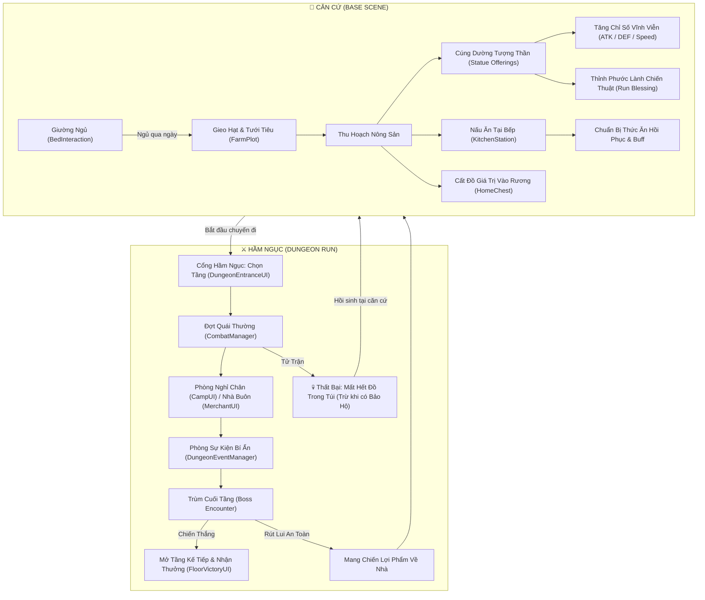

# PHÂN TÍCH TOÀN BỘ LOGIC HỆ THỐNG MÃ NGUỒN DỰ ÁN (DUNGEON FARM)

Tài liệu này tổng hợp và phân tích toàn bộ logic vận hành, luồng xử lý mã nguồn (code-level workflow), điều kiện kiểm tra (conditions), đột biến trạng thái (state mutations), và tương tác giữa các hệ thống trong dự án game.

---

## MỤC LỤC
1. [Kiến Trúc Tổng Thể & Vòng Lặp Gameplay (Core Loop)](#1-kiến-trúc-tổng-thể--vòng-lặp-gameplay-core-loop)
2. [Hệ Thống Nông Trại & Trồng Trọt (Farming System)](#2-hệ-thống-nông-trại--trồng-trọt-farming-system)
3. [Hệ Thống Túi Đồ & Rương Chứa (Inventory & Storage)](#3-hệ-thống-túi-đồ--rương-chứa-inventory--storage)
4. [Hệ Thống Thời Gian & Chu Kỳ Ngày Đêm (Day Cycle & Sleep)](#4-hệ-thống-thời-gian--chu-kỳ-ngày-đêm-day-cycle--sleep)
5. [Hệ Thống Bếp Nấu Ăn & Dinh Dưỡng (Kitchen & Cooking)](#5-hệ-thống-bếp-nấu-ăn--dinh-dưỡng-kitchen--cooking)
6. [Hệ Thống Tượng Thần, Hiến Tế & Phước Lành (Statue, Offerings & Blessings)](#6-hệ-thống-tượng-thần-hiến-tế--phước-lành-statue-offerings--blessings)
7. [Hệ Thống Thám Hiểm Hầm Ngục & Tầng Đấu (Dungeon Progression & Waves)](#7-hệ-thống-thám-hiểm-hầm-ngục--tầng-đấu-dungeon-progression--waves)
8. [Hệ Thống Chiến Đấu Theo Lượt (Turn-Based Combat System)](#8-hệ-thống-chiến-đấu-theo-lượt-turn-based-combat-system)
9. [Hệ Thống Chỉ Số Nhân Vật & Sinh Tồn (Player Stats & Attributes)](#9-hệ-thống-chỉ-số-nhân-vật--sinh-tồn-player-stats--attributes)

---

## 1. Kiến Trúc Tổng Thể & Vòng Lặp Gameplay (Core Loop)

Vòng lặp trò chơi đan xen chặt chẽ giữa 2 môi trường: **Căn Cứ (Base)** và **Hầm Ngục (Dungeon)**.



---

## 2. Hệ Thống Nông Trại & Trồng Trọt (Farming System)

* **Script chính:** [FarmPlot.cs](file:///c:/Users/dohuu/Documents/Unity/2D/Farming/Assets/_Scripts/FarmPlot.cs), [CropData.cs](file:///c:/Users/dohuu/Documents/Unity/2D/Farming/Assets/_Scripts/Data/CropData.cs), [PlayerInteraction.cs](file:///c:/Users/dohuu/Documents/Unity/2D/Farming/Assets/_Scripts/Player/PlayerInteraction.cs)
* **Máy trạng thái ô đất (`FarmPlot.State`):** `Empty` $\rightarrow$ `Planted` $\rightarrow$ `Ready`.

### 2.1. Thao tác Gieo Hạt (`FarmPlot.Planted`)
1. **Kích hoạt:** Người chơi đứng cách ô đất $\le 2.5$ đơn vị và Click chuột trái vào ô đất `Empty`.
2. **Kiểm tra tiền điều kiện:**
   - Kiểm tra ô đất: `currentState == State.Empty`.
   - Kiểm tra vật phẩm đang chọn: `InventoryButton.selectedItem != null`. Nếu rỗng $\rightarrow$ Thông báo: `"Hãy chọn hạt giống!"`.
   - Kiểm tra túi đồ người chơi: `itemContainer.HasItem(selectedItem)`. Nếu hết $\rightarrow$ Thông báo: `"Hết hạt giống trong túi!"`.
   - Đối chiếu danh sách cây trồng: Quét `availableCrops` tìm loại cây có `seedItem == selectedItem`. Nếu không khớp $\rightarrow$ Thông báo: `"Vật phẩm này không phải hạt giống!"`.
3. **Đột biến dữ liệu (Mutations):**
   - Trừ vật phẩm: `itemContainer.RemoveItem(selectedItem, 1);`.
   - Đặt trạng thái ô đất: `currentState = State.Planted;`.
   - Gán cây trồng: `currentCrop = selectedCrop;`.
   - Reset bộ đếm ngày: `currentGrowthDay = 0; currentStage = 0; daysInCurrentStage = 0;`.
   - Cập nhật Sprite mầm non: `cropRenderer.sprite = currentCrop.growthStages[0];`.
   - Hiện popup: `"Đã gieo " + selectedCrop.cropName`.
   - Lưu trữ: `SavePlotData()`.

### 2.2. Tiến trình Phát triển qua Ngày Mới (`FarmPlot.NextDay`)
1. **Kích hoạt:** Khi [DayManager.cs](file:///c:/Users/dohuu/Documents/Unity/2D/Farming/Assets/_Scripts/DayManager.cs) kích hoạt sự kiện `OnNewDay`.
2. **Kiểm tra trạng thái:** Bỏ qua nếu `currentState != State.Planted` hoặc `currentCrop == null`.
3. **Logic tính ngày (`NextDayInternal`):**
   - Tăng biến đếm: `currentGrowthDay++; daysInCurrentStage++;`.
   - Kiểm tra ngưỡng chuyển giai đoạn: `int effectiveGrowthTime = Mathf.Max(1, currentCrop.growthTime);`.
   - Nếu `daysInCurrentStage >= effectiveGrowthTime`:
     - Reset số ngày trong giai đoạn: `daysInCurrentStage = 0;`.
     - Xác định giai đoạn tối đa: `maxStage = currentCrop.growthStages.Length - 1;`.
     - Nếu `currentStage < maxStage`: `currentStage++;`.
     - Nếu `currentStage >= maxStage`: Chuyển trạng thái sang `currentState = State.Ready;`.
4. **Cập nhật hình ảnh (`UpdateCropVisual`):**
   - Lấy Sprite: `cropRenderer.sprite = currentCrop.growthStages[currentStage];`.
5. **Lưu dữ liệu:** `SavePlotData(false);`.

### 2.3. Kiểm tra Tiến độ Cây Trồng
* **Kích hoạt:** Click chuột trái vào ô đất đang ở trạng thái `Planted`.
* **Tính toán:**
  - Tổng số giai đoạn: `totalStages = currentCrop.growthStages.Length`.
  - Giai đoạn hiện tại: `stageNum = currentStage + 1`.
  - Số ngày còn lại để lớn: `daysNeeded = currentCrop.growthTime - daysInCurrentStage`.
  - Hiển thị popup xanh dương: `"{cropName}: Giai đoạn {stageNum}/{totalStages} (còn ~{daysNeeded} ngày)"`.

### 2.4. Thao tác Thu Hoạch (`FarmPlot.Harvest`)
1. **Kích hoạt:** Click chuột trái vào ô đất có `currentState == State.Ready`.
2. **Xử lý nông sản:**
   - Lấy số lượng: `harvestCount = Mathf.Max(1, currentCrop.harvestAmount);`.
   - Nếu có [ItemDropSpawner.cs](file:///c:/Users/dohuu/Documents/Unity/2D/Farming/Assets/_Scripts/Item/ItemDropSpawner.cs): Gọi `itemDropSpawner.SpawnItem(currentCrop.producedItem, harvestCount)` rơi ra đất để người chơi nhặt.
   - Nếu không có Spawner: Thêm trực tiếp vào túi đồ `itemContainer.AddItem(currentCrop.producedItem, harvestCount)`.
   - Hiện popup: `"Thu hoạch +{harvestCount} {cropName}!"`.
3. **Dọn sạch ô đất (`SetDefault`):**
   - `currentState = State.Empty; currentCrop = null;`.
   - `currentGrowthDay = 0; currentStage = 0; daysInCurrentStage = 0;`.
   - Khôi phục Sprite đất ban đầu: `cropRenderer.sprite = defaultSoilSprite;`.
   - `SavePlotData();`.

### 2.5. Cơ chế Lưu trữ Ô Đất (Persistence)
* **Khóa lưu (Save Key):** `FarmPlot_{Round(x*100)}_{Round(y*100)}`.
* **Dữ liệu lưu vào PlayerPrefs:** Trạng thái (`_State`), tên cây (`_Crop`), ngày lớn (`_GrowthDay`), giai đoạn (`_Stage`), ngày trong giai đoạn (`_DaysInStage`), ngày lưu cuối (`_SavedDay`).
* **Bù ngày khi nạp dữ liệu (`LoadPlotData`):**
  - Đọc `curDay` và `savedDay`.
  - Tính độ lệch ngày trôi qua: `daysPassed = curDay - savedDay`.
  - Vòng lặp chạy `NextDayInternal()` liên tiếp `daysPassed` lần $\rightarrow$ Đảm bảo cây vẫn lớn đúng hạn dù người chơi thoát game hoặc chuyển Scene.

---

## 3. Hệ Thống Túi Đồ & Rương Chứa (Inventory & Storage)

* **Script chính:** [ItemContainer.cs](file:///c:/Users/dohuu/Documents/Unity/2D/Farming/Assets/_Scripts/Inventory/ItemContainer.cs), [InventoryButton.cs](file:///c:/Users/dohuu/Documents/Unity/2D/Farming/Assets/_Scripts/Inventory/InventoryButton.cs), [InventoryController.cs](file:///c:/Users/dohuu/Documents/Unity/2D/Farming/Assets/_Scripts/Inventory/InventoryController.cs), [CurrentItemPanel.cs](file:///c:/Users/dohuu/Documents/Unity/2D/Farming/Assets/_Scripts/Inventory/CurrentItemPanel.cs), [HomeChest.cs](file:///c:/Users/dohuu/Documents/Unity/2D/Farming/Assets/_Scripts/Base/HomeChest.cs), [ChestUI.cs](file:///c:/Users/dohuu/Documents/Unity/2D/Farming/Assets/_Scripts/Base/ChestUI.cs)

### 3.1. Cấu Trúc Dữ Liệu
* **[ItemData.cs](file:///c:/Users/dohuu/Documents/Unity/2D/Farming/Assets/_Scripts/Data/ItemData.cs):**
  - `itemName`: Tên hiển thị.
  - `itemIcon`: Sprite hình ảnh icon.
  - `itemType`: Enum `Seed` (Hạt), `Produce` (Nông sản), `Food` (Món ăn), `Other`.
  - `isStackable`: Cho phép cộng dồn trong 1 ô hay không.
  - `isRare`: Đánh dấu vật phẩm hiếm chỉ rơi từ Boss.
* **[ItemContainer.cs](file:///c:/Users/dohuu/Documents/Unity/2D/Farming/Assets/_Scripts/Inventory/ItemContainer.cs):**
  - Mảng 20 ô `ItemSlot[] itemSlots`. Mỗi ô chứa `itemData` và `amount`.
  - Sự kiện `OnInventoryChange`: Kích hoạt mỗi khi có thao tác thêm/bớt/đổi ô để đồng bộ toàn bộ UI.

### 3.2. Thuật toán Thêm Vật Phẩm (`ItemContainer.AddItem`)
```csharp
if (itemData.isStackable)
{
    // 1. Quét tìm ô đã có item cùng loại để cộng dồn
    for (int i = 0; i < itemSlots.Length; i++) {
        if (IsItemMatch(itemSlots[i].itemData, itemData)) {
            itemSlots[i].amount += amount;
            OnInventoryChange?.Invoke();
            return true;
        }
    }
    // 2. Nếu chưa có, tìm ô trống đầu tiên (GetEmptySlot)
    int slot = GetEmptySlot();
    if (slot != -1) {
        itemSlots[slot].itemData = itemData;
        itemSlots[slot].amount = amount;
        OnInventoryChange?.Invoke();
        return true;
    }
    return false; // Hết chỗ chứa
}
```

### 3.3. Thao tác Người Chơi trên Giao diện
1. **Mở / Đóng túi đồ (Phím `I`):**
   - Nhấn phím `I` $\rightarrow$ [InventoryController.SwapInventoryPanel](file:///c:/Users/dohuu/Documents/Unity/2D/Farming/Assets/_Scripts/Inventory/InventoryController.cs#L30):
     - Bật bảng đầy đủ `inventoryPanel.SetActive(true)`.
     - Ẩn thanh công cụ nhanh `currentItemPanel.SetActive(false)`.
2. **Chọn vật phẩm (Click chuột trái):**
   - Click ô đồ $\rightarrow$ Gán `InventoryButton.selectedItem = currentItem;`.
   - Đổi viền ô sang xanh sáng (`Color(0.45f, 0.85f, 1f)`).
   - Click lại chính ô đó $\rightarrow$ Đặt `selectedItem = null` (Hủy chọn).
3. **Kéo thả sắp xếp (Drag & Drop):**
   - Nhấc item: Tạo GameObject ảo `DragIcon` gắn vào Canvas theo vị trí chuột.
   - Thả vào ô đích (`OnDrop`):
     - **Cùng túi:** Gọi `itemContainer.SwapSlots(sourceIndex, targetIndex)`. Nếu cùng loại stackable $\rightarrow$ Tự động gộp số lượng.
     - **Khác thùng chứa (Ba lô $\leftrightarrow$ Rương nhà):** Gọi `ChestUI.TransferItem(...)` để chuyển vật phẩm.
4. **Chuyển nhanh (Right-Click Quick Transfer):**
   - Khi đang mở Rương (`ChestUI.IsOpen`), click chuột phải vào slot bất kỳ để chuyển thẳng sang bên đối diện mà không cần kéo thả.

---

## 4. Hệ Thống Thời Gian & Chu Kỳ Ngày Đêm (Day Cycle & Sleep)

* **Script chính:** [DayManager.cs](file:///c:/Users/dohuu/Documents/Unity/2D/Farming/Assets/_Scripts/DayManager.cs), [BedInteraction.cs](file:///c:/Users/dohuu/Documents/Unity/2D/Farming/Assets/_Scripts/Player/PlayerInteraction.cs), [DayTransitionUI.cs](file:///c:/Users/dohuu/Documents/Unity/2D/Farming/Assets/_Scripts/DayTransitionUI.cs)

### 4.1. Bộ Đếm Thời Gian Tự Động (`DayTimer`)
- Khi người chơi ở Căn cứ (`runActive == false`):
- Đồng hồ chạy `yield return new WaitForSeconds(dayDuration);` (mặc định 120 giây).
- Khi hết thời gian: Kích hoạt hiệu ứng chuyển ngày và gọi `AdvanceDay()`.

### 4.2. Thao tác Ngủ Qua Ngày (`Sleep`)
- Người chơi đứng gần Giường ngủ bấm phím **`E`** $\rightarrow$ Gọi [DayManager.Instance.Sleep()](file:///c:/Users/dohuu/Documents/Unity/2D/Farming/Assets/_Scripts/DayManager.cs#L121).
- Bắn sự kiện `OnDaySleep`.
- Gọi [DayTransitionUI.PlayTransition](file:///c:/Users/dohuu/Documents/Unity/2D/Farming/Assets/_Scripts/DayTransitionUI.cs#L107): làm mờ màn hình (Fade out đen), chạy tiếng chuông sáng và gọi hàm qua ngày.

### 4.3. Quá trình Qua Ngày Mới (`AdvanceDay`)
1. Tăng ngày: `currentDay++; PlayerPrefs.SetInt("Farm_CurrentDay", currentDay);`.
2. Kích hoạt sự kiện: `OnNewDay?.Invoke();` $\rightarrow$ Tất cả các ô đất `FarmPlot` trên bản đồ nhận tín hiệu và tăng trưởng cây.
3. Lưu toàn bộ dữ liệu: `PlayerPrefs.Save();`.
4. Làm sạch trạng thái ngày cũ:
   - Xóa phước lành tạm thời của ngày hôm trước: `ProgressionManager.Instance.ClearRunBlessing();`.
   - Xóa buff thức ăn tạm thời: `PlayerStats.Instance.ClearTemporaryBuffs();`.
5. Báo cáo buổi sáng trên [DayTransitionUI](file:///c:/Users/dohuu/Documents/Unity/2D/Farming/Assets/_Scripts/DayTransitionUI.cs):
   - Quét tìm tất cả `FarmPlot` trong Scene.
   - Thống kê: Số ô đất chín rộ (`State.Ready`), số ô đang lớn (`State.Planted`), số ô đất trống.
   - Liệt kê chi tiết số lượng từng loại nông sản đã chín (ví dụ: *Cà chua x3, Lúa mì x2*).

---

## 5. Hệ Thống Bếp Nấu Ăn & Dinh Dưỡng (Kitchen & Cooking)

* **Script chính:** [KitchenStation.cs](file:///c:/Users/dohuu/Documents/Unity/2D/Farming/Assets/_Scripts/Base/KitchenStation.cs), [KitchenUI.cs](file:///c:/Users/dohuu/Documents/Unity/2D/Farming/Assets/_Scripts/Base/KitchenUI.cs), [FoodRecipeData.cs](file:///c:/Users/dohuu/Documents/Unity/2D/Farming/Assets/_Scripts/Data/FoodRecipeData.cs), [FoodData.cs](file:///c:/Users/dohuu/Documents/Unity/2D/Farming/Assets/_Scripts/Data/FoodData.cs)

### 5.1. Tương tác Mở Bếp
- Người chơi đứng cách trạm bếp $\le 1.6$ đơn vị bấm phím **`E`** hoặc click chuột trái.
- Gọi [KitchenUI.Instance.Open(this, backpackContainer, chestContainer)](file:///c:/Users/dohuu/Documents/Unity/2D/Farming/Assets/_Scripts/Base/KitchenUI.cs#L118).
- Giao diện gồm 3 khu vực: Ô nồi nấu (`potSlots`), Bảng nguyên liệu lấy từ ba lô / rương, Bảng sách công thức nấu ăn.

### 5.2. Quy Trình Nấu Món Ăn
1. **Đưa nguyên liệu vào nồi:** Kéo nông sản từ ba lô thả vào các ô trong nồi (`potSlots`).
2. **Quét công thức nấu (`MatchRecipe`):**
   - Quét danh sách nguyên liệu hiện có trong nồi.
   - So sánh với các tài nguyên `FoodRecipeData`:
     - Nếu nguyên liệu trong nồi khớp hoàn toàn với danh sách `requiredIngredients`: Kích hoạt nút **NẤU (COOK)** và hiển thị tên món ăn sắp hoàn thành.
3. **Thực thi nấu:**
   - Trừ nông sản trong các ô nồi nấu.
   - Tạo món ăn thành phẩm [FoodData](file:///c:/Users/dohuu/Documents/Unity/2D/Farming/Assets/_Scripts/Data/FoodData.cs) đưa trực tiếp vào túi đồ: `backpackContainer.AddItem(producedFood, 1)`.
   - Chạy hiệu ứng khói/âm thanh nấu nướng và hiển thị Popup kết quả.

### 5.3. Sử dụng Món Ăn & Cơ chế Dinh Dưỡng ([PlayerStats.Eat](file:///c:/Users/dohuu/Documents/Unity/2D/Farming/Assets/_Scripts/Player/PlayerStats.cs#L150))
* **Điều kiện ăn:** Người chơi chưa đầy máu HOẶC chưa đầy độ no HOẶC món ăn có chứa Buff chiến đấu.
* **Tác dụng:**
  - Hồi máu: `Heal(food.healthValue);`.
  - Tăng độ no: `AddHunger(food.hungerValue);`.
  - **Kích hoạt Buff chỉ số (`AddBuff`):**
    - Đọc mảng `foodBuff[]`: Loại buff (ATK, DEF, Speed), giá trị tăng, thời lượng `buffDuration`.
    - Phân loại thời hạn `buffDurationType`:
      - `BuffDurationType.Turn`: Giảm 1 lượt sau mỗi lượt kết thúc trong combat.
      - `BuffDurationType.Floor`: Giảm 1 tầng sau khi hoàn thành 1 tầng hầm ngục.
  - Trừ 1 món ăn khỏi túi đồ: `itemContainer.RemoveItem(food, 1);`.

---

## 6. Hệ Thống Tượng Thần, Hiến Tế & Phước Lành (Statue, Offerings & Blessings)

* **Script chính:** [Statue.cs](file:///c:/Users/dohuu/Documents/Unity/2D/Farming/Assets/_Scripts/Statue.cs), [StatueUI.cs](file:///c:/Users/dohuu/Documents/Unity/2D/Farming/Assets/_Scripts/Base/StatueUI.cs), [OfferingSlot.cs](file:///c:/Users/dohuu/Documents/Unity/2D/Farming/Assets/_Scripts/Base/OfferingSlot.cs), [ProgressionManager.cs](file:///c:/Users/dohuu/Documents/Unity/2D/Farming/Assets/_Scripts/Progression/ProgressionManager.cs)

### 6.1. Hiến Tế Nhận Thuộc Tính Vĩnh Viễn (Offerings)
1. **Nộp nông sản vào thẻ hiến tế:**
   - Người chơi kéo nông sản từ ba lô thả vào `OfferingSlot` (hoặc Click trực tiếp, hoặc bấm **Quick Offer**).
   - Kiểm tra: Đúng loại nông sản yêu cầu và ô chưa hoàn thành.
   - Tính toán nạp: `deposit = Mathf.Min(sourceSlot.amount, needed);`.
   - Trừ vật phẩm từ túi và lưu tiến độ: `ProgressionManager.Instance.AddOfferingProgress(offeringKey, reqIndex, deposit);`.
2. **Hoàn thành Thẻ Cúng Dường ([CheckOfferingCompletion](file:///c:/Users/dohuu/Documents/Unity/2D/Farming/Assets/_Scripts/Base/StatueUI.cs#L212)):**
   - Khi tất cả các dòng yêu cầu trong thẻ đạt đủ số lượng:
   - Đánh dấu hoàn thành: `ProgressionManager.Instance.CompleteOffering(offeringKey);`.
   - **Tăng chỉ số vĩnh viễn:** `ProgressionManager.Instance.AddPermanentStat(rewardStat, rewardAmount);`.
     - Nhận ATK: `permanentATK += rewardAmount;`.
     - Nhận DEF: `permanentDEF += rewardAmount;`.
     - Nhận Speed: `permanentSpeed += rewardAmount;`.
   - Cập nhật sang người chơi: `playerStats.RefreshStatsFromProgression();`.
   - Popup vàng chúc mừng: `"+{rewardAmount} {rewardStat} VĨNH VIỄN!"`.

### 6.2. Thao tác Chọn Phước Lành Run (Run Blessings / Build Direction)
Bấm nút **"Thỉnh Phước Lành / Đổi Hướng Build"** $\rightarrow$ Mở bảng 8 Thẻ Phước Lành:

| Phước Lành (`BlessingType`) | Điều kiện Mở Khóa (`IsBlessingUnlocked`) | Cơ chế Tác động trong Combat & Dungeon |
| :--- | :--- | :--- |
| **Bảo Hộ Thần Linh** (`KeepLootOnDefeat`) | Mở sẵn mặc định từ đầu | Khi ngã xuống trong Dungeon, **không bị xóa sạch túi đồ** (`ClearRunLoot` bị chặn). |
| **Lấy Thủ Làm Công** (`BastionStrike`) | Vượt Tầng 1 **HOẶC** đã có Cúng dường DEF | Cộng thêm **50% DEF vào ATK**; hành động Phòng Thủ (`Defend`) hồi lại ngay **+1 AP**. |
| **Động Lực Tốc Độ** (`SwiftMomentum`) | Vượt Tầng 1 **HOẶC** đã có Cúng dường Speed | Tăng **+4 Tốc độ**; đòn đánh gây thêm sát thương bằng đúng chênh lệch tốc độ giữa bạn và quái. |
| **Bụng Rỗng Cuồng Nộ** (`StarvingFury`) | Vượt Tầng 1 **HOẶC** đã có Cúng dường ATK | Khi Độ no $< 35\%$: tăng **+6 ATK** và **35% tỷ lệ Bạo kích x1.5 sát thương**. |
| **No Căng Phản Đòn** (`GluttonousAegis`) | Đánh bại Boss và Vượt Tầng 2 | Khi Độ no $\ge 70\%$: nhận **+8 DEF** và **phản lại 40% sát thương** gánh chịu ngược lại quái vật. |
| **Đại Tiệc Bất Tận** (`EndlessFeast`) | Hoàn thành $\ge 2$ Cúng dường **HOẶC** Vượt Tầng 3 | **Gấp đôi thời lượng mọi buff thức ăn**; món ăn đầu tiên mỗi lượt tốn **0 AP**. |
| **Món Đắng Bào Mòn** (`BitterDecay`) | Đánh bại Boss và Vượt Tầng 2 | Mọi đòn đánh thường **bào mòn 2 DEF của quái** và găm thêm **4 sát thương độc** trực tiếp. |
| **Nông Dân Cường Tráng** (`RawVitality`) | Hoàn thành bất kỳ 1 Cúng dường nào | Cho phép **ăn trực tiếp nông sản sống** trong Dungeon để hồi +12 HP và +20 Độ no. |

---

## 7. Hệ Thống Thám Hiểm Hầm Ngục & Tầng Đấu (Dungeon Progression & Waves)

* **Script chính:** [DungeonEntranceUI.cs](file:///c:/Users/dohuu/Documents/Unity/2D/Farming/Assets/_Scripts/DungeonEntranceUI.cs), [WaveManager.cs](file:///c:/Users/dohuu/Documents/Unity/2D/Farming/Assets/_Scripts/WaveManager.cs), [FloorVictoryUI.cs](file:///c:/Users/dohuu/Documents/Unity/2D/Farming/Assets/_Scripts/Dungeon/FloorVictoryUI.cs), [CampUI.cs](file:///c:/Users/dohuu/Documents/Unity/2D/Farming/Assets/_Scripts/Dungeon/CampUI.cs), [MerchantUI.cs](file:///c:/Users/dohuu/Documents/Unity/2D/Farming/Assets/_Scripts/Dungeon/MerchantUI.cs), [DungeonEventManager.cs](file:///c:/Users/dohuu/Documents/Unity/2D/Farming/Assets/_Scripts/Dungeon/DungeonEventManager.cs)

### 7.1. Bắt Đầu Chuyến Đi (Dungeon Run)
1. Người chơi tương tác với Cổng Hầm Ngục [DungeonEntranceUI.cs](file:///c:/Users/dohuu/Documents/Unity/2D/Farming/Assets/_Scripts/DungeonEntranceUI.cs).
2. Chọn Tầng xuất phát: `floor <= ProgressionManager.Instance.highestUnlockedFloor`.
3. Khởi chạy: `ProgressionManager.Instance.StartRun(floor);` $\rightarrow$ Đặt `runActive = true; currentFloor = floor;`.

### 7.2. Điều Phối Chuỗi Phòng ([WaveManager.cs](file:///c:/Users/dohuu/Documents/Unity/2D/Farming/Assets/_Scripts/WaveManager.cs))
Mỗi Tầng trong hầm ngục được chia thành nhiều phòng/đợt liên tiếp:
1. **Phòng Chiến Đấu Thường (Combat Waves):**
   - Sinh danh sách quái vật theo cấu hình tầng: `combatManager.SetEnemies(enemies);`.
   - Bắt đầu trận chiến: `combatManager.StartCombat(isAmbush);`.
2. **Phòng Trại Nghỉ Dã Chiến ([CampUI.cs](file:///c:/Users/dohuu/Documents/Unity/2D/Farming/Assets/_Scripts/Dungeon/CampUI.cs)):**
   - Xuất hiện giữa các đợt căng thẳng:
   - Cho phép người chơi đốt lửa trại nghỉ ngơi, hồi phục HP/Hunger, hoặc nấu ăn tạm thời.
3. **Phòng Nhà Buôn Hầm Ngục ([MerchantUI.cs](file:///c:/Users/dohuu/Documents/Unity/2D/Farming/Assets/_Scripts/Dungeon/MerchantUI.cs)):**
   - Mua các hạt giống hiếm (Rare Seeds), thuốc trợ lực, bán nông sản lấy tiền vàng.
4. **Phòng Sự Kiện Ngẫu Nhiên ([DungeonEventManager.cs](file:///c:/Users/dohuu/Documents/Unity/2D/Farming/Assets/_Scripts/Dungeon/DungeonEventManager.cs)):**
   - Đưa ra các lựa chọn đánh đổi rủi ro (ví dụ: *Hiến máu lấy bùa chú, Mở rương bị nguyền rủa*).
5. **Phòng Trùm Cuối Tầng (Boss Wave):**
   - Xuất hiện quái Boss có lượng máu lớn và bộ chiêu thức độc nhất.
   - Tiêu diệt Boss:
     - Ghi nhận: `ProgressionManager.Instance.RecordBossDefeated(currentFloor);`.
     - Mở khóa Tầng kế tiếp: `highestUnlockedFloor = Mathf.Max(highestUnlockedFloor, currentFloor + 1);`.
     - Hiện bảng [FloorVictoryUI.cs](file:///c:/Users/dohuu/Documents/Unity/2D/Farming/Assets/_Scripts/Dungeon/FloorVictoryUI.cs) cho phép chọn: **Tiến Lên Tầng Tiếp Theo** hoặc **Rút Lui An Toàn Về Căn Cứ**.

---

## 8. Hệ Thống Chiến Đấu Theo Lượt (Turn-Based Combat System)

* **Script chính:** [CombatManager.cs](file:///c:/Users/dohuu/Documents/Unity/2D/Farming/Assets/_Scripts/Combat/CombatManager.cs), [TurnManager.cs](file:///c:/Users/dohuu/Documents/Unity/2D/Farming/Assets/_Scripts/Combat/TurnManager.cs), [SpeedManager.cs](file:///c:/Users/dohuu/Documents/Unity/2D/Farming/Assets/_Scripts/Combat/SpeedManager.cs), [EnemyStats.cs](file:///c:/Users/dohuu/Documents/Unity/2D/Farming/Assets/_Scripts/Combat/EnemyStats.cs), [CombatUI.cs](file:///c:/Users/dohuu/Documents/Unity/2D/Farming/Assets/_Scripts/Combat/CombatUI.cs), [CombatJuice.cs](file:///c:/Users/dohuu/Documents/Unity/2D/Farming/Assets/_Scripts/Combat/CombatJuice.cs), [DamagePopupManager.cs](file:///c:/Users/dohuu/Documents/Unity/2D/Farming/Assets/_Scripts/Combat/DamagePopupManager.cs)

### 8.1. Khởi Tạo & Tính Toán Thứ Tự Lượt Đi
1. **Chuẩn bị 3 giây:** `isPreparingCombat = true;`, quái chọn trước ý định (`SelectNextIntent`).
2. **Sắp xếp tốc độ ([SpeedManager.CreateSpeedOrder](file:///c:/Users/dohuu/Documents/Unity/2D/Farming/Assets/_Scripts/Combat/SpeedManager.cs#L38)):**
   - Thu thập chỉ số `GetCurrentSpeed()` của người chơi và tất cả quái vật sống.
   - Sắp xếp giảm dần theo tốc độ: ai có tốc độ cao hơn sẽ đi trước trong Round.
   - Nếu bị đánh úp (`isAmbush == true`): Quái vật được đẩy lên đi trước toàn bộ, người chơi đi cuối cùng.

### 8.2. Lượt của Người Chơi (`Turn.Player`)
Đầu lượt, hồi đầy `playerStats.currentAP = 3; defendCount = 0;`. Người chơi dùng các phím tắt:

#### 1. Tấn Công (Attack - Phím `1`):
- Điều kiện: Còn AP (`currentAP > 0`), mục tiêu sống.
- Tính sát thương: `atk = playerStats.GetCurrentATK();`.
  - Nếu có *SwiftMomentum*: `atk += Mathf.Max(0, playerSpeed - enemySpeed);`.
  - Nếu có *StarvingFury* (No $<35\%$): 35% tỷ lệ bạo kích `atk = RoundToInt(atk * 1.5f);`.
- Gây sát thương: `dealtDamage = target.TakeDamage(atk);`.
- Trừ 1 AP: `playerStats.currentAP--;`.
- Phụ hiệu *BitterDecay*: Bào mòn `target.ReduceDEF(2);` và găm 4 sát thương độc.
- Nếu mục tiêu chết: Tự động đổi hồng tâm sang quái kế tiếp.

#### 2. Phòng Thủ (Defend - Phím `2`):
- Điều kiện: Còn AP (`currentAP > 0`).
- Tăng cộng dồn khiên: `playerStats.Defend();` $\rightarrow$ `defendCount++;`.
- Trừ 1 AP: `playerStats.currentAP--;`.
- Phước lành *BastionStrike*: Lần đầu phòng thủ trong lượt hồi lại ngay `+1 AP`.
- Popup thông báo: `"+{defendValue} DEF"`.

#### 3. Ăn Uống (Eat - Phím `3`):
- Mở danh sách món ăn từ ba lô $\rightarrow$ Click chọn món muốn ăn.
- Gọi `playerStats.Eat(food)`: Hồi máu, tăng điểm no, nhận buff chỉ số.
- Trừ 1 AP (Nếu có phước lành *EndlessFeast*: Món đầu tiên trong hiệp tốn **0 AP**).

#### 4. Đổi Mục Tiêu (Target - Phím `Tab` / `A`-`D` / Click chuột):
- Gọi `targetSelector.CycleTarget(...)` hoặc chọn trực tiếp quái vật trên màn hình.

#### 5. Kết Thúc Lượt (End Turn - Phím `Space` / `Enter`):
- Giảm 1 lượt thời hạn của tất cả buff hiệp đấu: `playerStats.ReduceTurnBuffDuration();`.
- Chuyển lượt sang thực thể tiếp theo trong danh sách `speedOrder`.

### 8.3. Lượt của Quái Vật (`Turn.Enemy`)
1. Chờ độ trễ: 1.2 giây.
2. Thực thi ý định đã báo trước ([EnemyStats.PerformIntentAction](file:///c:/Users/dohuu/Documents/Unity/2D/Farming/Assets/_Scripts/Combat/EnemyStats.cs#L256)):
   - **`Attack`:** Tính `dmg = Mathf.Max(0, enemy.ATK - player.DEF - (player.defendCount * player.defendValue));` $\rightarrow$ `playerStats.TakeDamage(dmg);`.
   - **`Defend`:** Quái bật cờ thủ `isDefending = true;` nhận thêm `+defendBonus DEF`.
   - **`Buff`:** Tăng thuộc tính cho bản thân hoặc toàn bộ đồng minh.
   - **`Debuff`:** Găm hiệu ứng làm suy yếu người chơi.
3. **Phản đòn (Phước lành *GluttonousAegis*):**
   - Nếu người chơi có Độ no $\ge 70\%$: Phản lại 40% sát thương nhận vào: `ReflectDamageToCurrentEnemy(RoundToInt(damage * 0.4f));`.
4. Quái chọn ngẫu nhiên ý định mới cho lượt sau: `SelectNextIntent();`.
5. Giảm thời hạn buff của quái và chuyển lượt sang nhân vật kế tiếp.

### 8.4. Phân Định Thắng / Thua
* **Chiến Thắng (`CheckAllEnemiesDead`):**
  - Tất cả quái cạn máu: Kích hoạt quay chậm kết liễu `CombatJuice.Instance.PlayFinisherSlowMo(0.25f, 0.45f)`.
  - Gom toàn bộ đồ rơi `GetLootDrops()` vào danh sách `currentWaveLoot`.
  - Sau 1 giây trễ: Bắn `OnCombatEnded` và mở bảng nhặt đồ [LootUI.cs](file:///c:/Users/dohuu/Documents/Unity/2D/Farming/Assets/_Scripts/LootUI.cs).
* **Thất Bại (`HandlePlayerDeath`):**
  - Máu người chơi về 0: Gọi `ProgressionManager.Instance.HandlePlayerDeathWithoutReload`.
  - Đặt `runActive = false;`.
  - **Mất đồ:** Nếu không có phước lành *Bảo Hộ Thần Linh (`KeepLootOnDefeat`)* $\rightarrow$ Gọi `ClearRunLoot(inventory)`, xóa sạch toàn bộ vật phẩm trong ba lô!
  - Xóa buff tạm thời, hiện thông báo Tử trận và đưa người chơi hồi sinh về Căn cứ.

---

## 9. Hệ Thống Chỉ Số Nhân Vật & Sinh Tồn (Player Stats & Attributes)

* **Script chính:** [PlayerStats.cs](file:///c:/Users/dohuu/Documents/Unity/2D/Farming/Assets/_Scripts/Player/PlayerStats.cs)

### 9.1. Công Thức Tính Chỉ Số Động
Mỗi khi thuộc tính được truy vấn (`GetCurrentATK`, `GetCurrentDEF`, `GetCurrentSpeed`), hệ thống cộng dồn từ 4 nguồn:

$$\text{Thuộc Tính Tổng} = \text{Chỉ Số Gốc} + \text{Cúng Dường Tượng (Vĩnh Viễn)} + \text{Hiệu Ứng Thức Ăn (Buff)} + \text{Phước Lành Thần Linh}$$

1. **Chỉ số Tấn Công (`GetCurrentATK`):**
   - Base ATK + `permanentATK`.
   - Cộng thêm từ Buff thức ăn loại `Attack`.
   - Nếu có *BastionStrike*: Cộng thêm `+50% DEF`.
   - Nếu có *StarvingFury* (No $<35\%$): Cộng thêm `+6 ATK`.
2. **Chỉ số Phòng Thủ (`GetCurrentDEF`):**
   - Base DEF + `permanentDEF`.
   - Cộng thêm từ Buff thức ăn loại `Defense`.
   - Nếu có *GluttonousAegis* (No $\ge 70\%$): Cộng thêm `+8 DEF`.
3. **Chỉ số Tốc Độ (`GetCurrentSpeed`):**
   - Base Speed + `permanentSpeed`.
   - Cộng thêm từ Buff thức ăn loại `Speed`.
   - Nếu có *SwiftMomentum*: Cộng thêm `+4 Speed`.

### 9.2. Hệ Thống Điểm Đói (Hunger)
- Độ no giảm dần qua các hành động khám phá hầm ngục.
- Khi đói bụng ($\le 35\%$): Tương thích với lối build Liều mạng - Bạo kích (*StarvingFury*).
- Khi no nê ($\ge 70\%$): Tương thích với lối build Đỡ đòn - Phản pháo (*GluttonousAegis*).
- Không tự động trừ đói khi ở Căn cứ an toàn để tạo không gian thư giãn cho người chơi làm nông.
